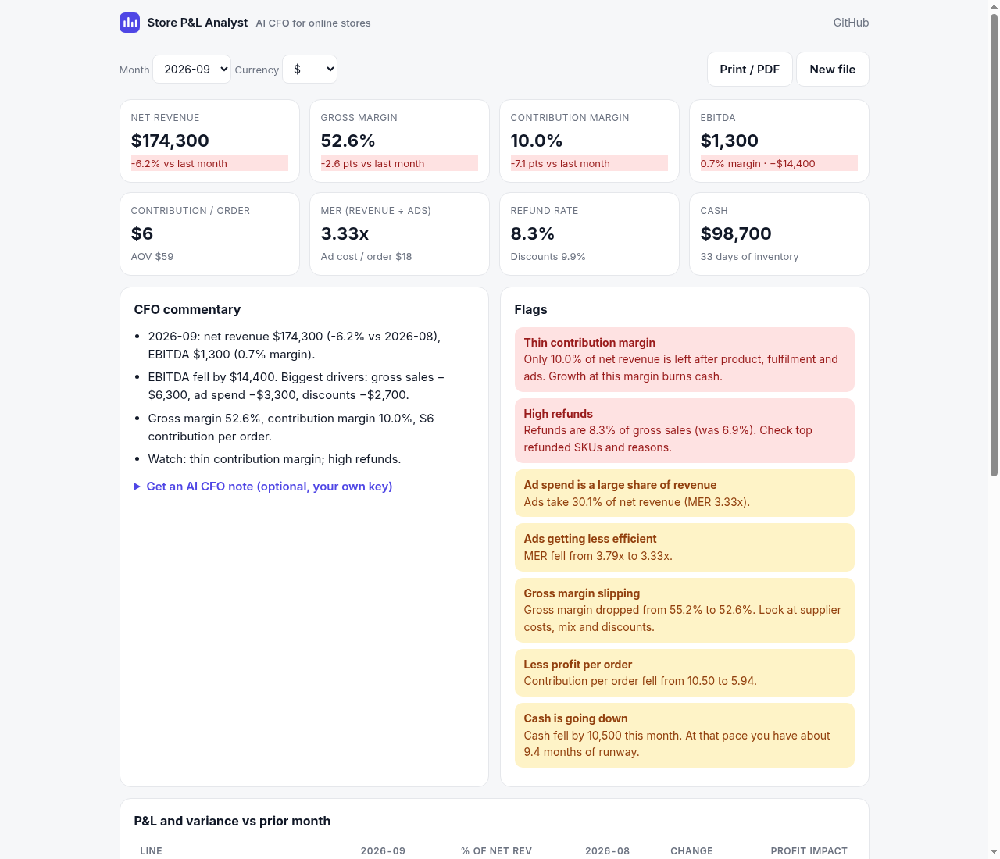

# Store P&L Analyst: an AI CFO for online stores

**[Try it live →](https://madebysid.github.io/store-pnl-analyst/)** · [Open with sample data](https://madebysid.github.io/store-pnl-analyst/?sample)

Upload your store's monthly P&L as a CSV and get a month-end review in seconds: margin breakdown, variance vs last month, an EBITDA bridge, unit economics and cash flags, and CFO-style commentary. Everything is calculated in your browser. There's no sign-up, no server and no data upload.



## What you get

- **KPIs:** net revenue, gross margin, contribution margin, EBITDA, contribution per order, AOV, MER (revenue ÷ ad spend), ad cost per order, refund and discount rates, cash and inventory days.
- **P&L with variance:** every line vs the prior month, as % of net revenue, with its impact on profit.
- **What moved EBITDA:** a bridge ranking the lines that drove the change (it reconciles to the EBITDA change exactly).
- **Flags:** loss-making month, thin contribution margin, high refunds, heavy discounting, ad spend share, falling MER, gross margin slippage, orders that lose money after ads, cash tied up in stock, cash burn and runway.
- **Commentary:** a rule-based summary for free. Optionally paste your own OpenAI or Anthropic key for an AI CFO note with three actions for next month. Only summary metrics are sent, straight from your browser to the provider, and the key is not stored.

## CSV format

One row per month. Required: `month`, `gross_sales`, `cogs`. Optional: `discounts`, `refunds`, `shipping`, `payment_fees`, `ad_spend`, `apps_software`, `payroll`, `other_opex`, `orders`, `ending_cash`, `ending_inventory`. Common names such as `revenue`, `marketing`, `fees` or `cost of goods sold` are recognised, and values like `$1,200` or `(300)` are fine. See [the template](site/sample/store_pnl_sample.csv).

## Run locally

```bash
npm test        # 10 tests, Node 18+
npm run serve   # http://localhost:8000
```

No dependencies or build step: `site/` is static HTML and JavaScript (`site/pnl.js` holds all the maths).

## Credits

Based on the [AI Financial Coach Agent](https://github.com/Shubhamsaboo/awesome-llm-apps/tree/main/advanced_ai_agents/multi_agent_apps/ai_financial_coach_agent) from [Shubhamsaboo/awesome-llm-apps](https://github.com/Shubhamsaboo/awesome-llm-apps) (Apache-2.0). The original is a personal-finance multi-agent app (budget, savings and debt agents). This version adapts the idea of staged financial analysis followed by an AI advisor note to ecommerce store P&Ls, and moves it to a browser-only app. Licensed under Apache-2.0; see [LICENSE](LICENSE).

Built by [Siddharth Kumar](https://sidailab.com): ex-Amazon finance partner, now running the P&Ls of about 50 Shopify stores. Also see [Shopify Weekly Business Review](https://madebysid.github.io/shopify-wbr/).
